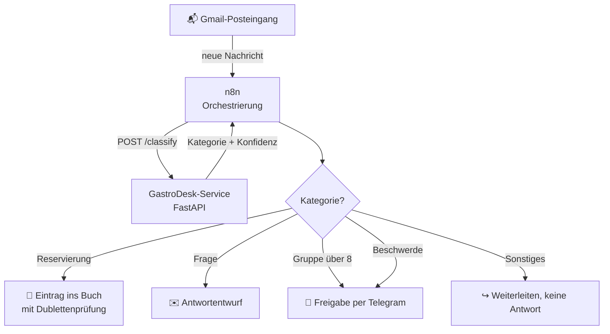

# 🍽️ GastroDesk

**Ein KI-Agent, der den Mail-Eingang eines Restaurants bearbeitet.**
Er sortiert Gästepost, schreibt Antwortentwürfe, trägt Reservierungen ein — und
fragt bei heiklen Fällen erst einen Menschen.


---

## Das Problem

Ein Restaurant-Inhaber liest seine Mails nachts um eins, nach dem Service. Jeder
Tag bringt Reservierungen, Allergiefragen, Gruppenanfragen und Beschwerden —
vermischt mit Lieferantenrechnungen und Kaltakquise.

**Das Sortieren ist die Arbeit. Das Antworten ist der leichte Teil.**

GastroDesk übernimmt das Sortieren, schreibt die Entwürfe und gibt ihm diese
Stunde zurück.

## Architektur



**Warum diese Aufteilung:** n8n orchestriert, ein Python-Service denkt. Der
Service trägt die Tests und die Messzahlen; n8n trägt die Verdrahtung, die man
auf einen Blick versteht. Ein Repository, dessen Substanz ein exportiertes
Workflow-JSON ist, lässt sich weder lesen noch testen.

## Was der Agent tut

| Kategorie | Aktion | Mensch im Spiel? |
|---|---|---|
| **Reservierung** | Trägt ein, erkennt Doppelbuchungen, bestätigt per Mail | nein |
| **Frage** | Antwortentwurf, schlägt Allergene in der Speisekarte nach | Entwurf freigeben |
| **Gruppe** | Antwortentwurf | ja, über 8 Personen |
| **Beschwerde** | Antwortet **nie** automatisch | ja, immer |
| **Sonstiges** | Leitet weiter — Lieferantenpost ist keine Gästepost | ja |

## Messung statt Behauptung

Die Klassifizierung wird gegen **30 handgeschriebene Anfragen mit bekanntem
Soll-Label** gemessen ([`fixtures/emails.jsonl`](fixtures/emails.jsonl)) —
getrennt ausgewertet für einfache und schwere Fälle.

13 der 30 Fälle sind bewusst knifflig, weil 95 % Treffer auf 30 einfachen Mails
nichts beweisen. Enthalten sind unter anderem:

- dieselbe Buchung zweimal geschickt — die Dublettenprüfung muss die zweite abfangen
- eine **Absage**, die keine Reservierung anlegen darf
- genau **8 Gäste**, die Grenze der Freigaberegel
- Beschwerden, so höflich formuliert, dass sie wie Fragen klingen

Details und Begründung: [`fixtures/README.md`](fixtures/README.md)

> **Die Genauigkeitszahl steht hier, sobald der Eval-Harness läuft.** Vorher
> wird hier nichts behauptet.

## Stand der Arbeit

- [x] Messdatensatz mit 30 Fällen und Soll-Labels
- [x] n8n lokal lauffähig ([`n8n/`](n8n/))
- [ ] Erster Workflow: Mail rein, Kategorie raus
- [ ] Klassifizierer mit Prompt Caching
- [ ] Eval-Harness und erste Messzahl
- [ ] Reservierungsbuch mit Dublettenprüfung
- [ ] Freigabe-Schritt per Telegram
- [ ] Demo-Video

## Schnellstart

n8n hochfahren:

```bash
cd n8n && docker compose up -d
```

Oberfläche: <http://localhost:5678>

Mehr dazu — inklusive Volume-Handhabung und Workflow-Export — in
[`n8n/README.md`](n8n/README.md).

> Der Python-Service ist noch nicht gebaut. Sobald er steht, ist das Ziel
> `docker compose up` plus ein Kommando.

## Projektstruktur

```
gastrodesk/
├── fixtures/          Messdatensatz mit Soll-Labels
├── n8n/               Container-Setup und exportierte Workflows
├── src/gastrodesk/    Python-Service (in Arbeit)
└── tests/             pytest-Suite (in Arbeit)
```

## Grenzen des Projekts

Werden hier ehrlich dokumentiert, sobald sie sich zeigen — nicht als Floskel:
Ein Projekt ohne benannte Grenzen hat sie nur nicht gesucht.

## Lizenz

MIT — siehe [LICENSE](LICENSE).
